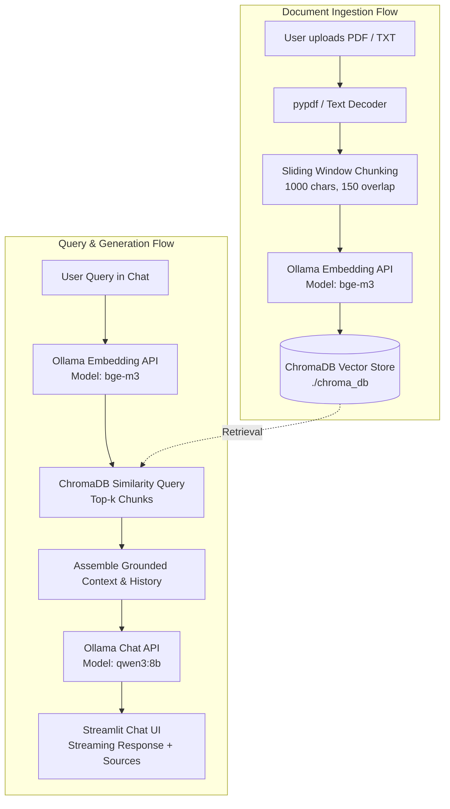

# 🤖 Local AI Chat + RAG

[](https://www.python.org/)
[](https://streamlit.io/)
[](https://ollama.ai/)
[](https://www.trychroma.com/)
[](LICENSE)

A fully **local**, **private**, and **air-gapped** Retrieval-Augmented Generation (RAG) conversational application. Ask questions about your PDF and text documents with direct source citations and streaming responses—powered completely on your machine with **Ollama**, **Qwen3**, **BGE-M3**, and **ChromaDB**. No data leaves your computer, and no paid API keys are required.

---

## 📑 Table of Contents

- [Overview](#-overview)
- [Key Features](#-key-features)
- [Architecture & Workflow](#-architecture--workflow)
- [Tech Stack](#-tech-stack)
- [Prerequisites](#-prerequisites)
- [Installation & Quickstart](#-installation--quickstart)
- [Running the Application](#-running-the-application)
- [Sample Documents](#-sample-documents)
- [Configuration & Customization](#-configuration--customization)
- [Project Directory Structure](#-project-directory-structure)
- [Troubleshooting](#-troubleshooting)
- [Future Roadmap](#-future-roadmap)
- [License](#-license)

---

## 🌟 Overview

Cloud-hosted AI solutions expose sensitive personal and corporate data to external servers and incur per-token API costs. **Local AI Chat + RAG** brings modern conversational AI and semantic document search directly to your local hardware.

By combining:
- **Ollama** for lightweight local model serving
- **Qwen3 (8B)** for conversational inference and grounded reasoning
- **BGE-M3** for multilingual, dense text embeddings
- **ChromaDB** for on-disk persistent vector indexing
- **Streamlit** for a clean, responsive web interface

...you get an intuitive, zero-cost, enterprise-grade document assistant that runs offline.

---

## ✨ Key Features

- **🔒 100% Local & Private**: No cloud APIs, no external telemetry, and no data leaves your local environment.
- **📄 Multi-Format Ingestion**: Upload and index both `.pdf` and `.txt` documents seamlessly.
- **⚡ Fast Semantic Search**: Sliding window chunking (1000 characters with 150-character overlap) coupled with dense vector embeddings via BGE-M3.
- **💾 Persistent Vector Storage**: Indexed documents are saved in a local ChromaDB directory (`./chroma_db`), avoiding re-indexing on every application restart.
- **🌊 Token-by-Token Streaming**: Responses are streamed in real time using Streamlit's native `st.write_stream` and Ollama's streaming API.
- **📌 Source Citations**: Automatically tracks metadata and displays which source documents provided the context for the answer.
- **🧠 Grounded System Instructions**: System prompts enforce truthfulness, instructing the model to rely strictly on document context and avoid hallucinations.
- **🧹 One-Click Management**: Intuitive sidebar controls to monitor chunk count, clear conversation history, or wipe the vector index.

---

## 🏗️ Architecture & Workflow



---

## 🛠️ Tech Stack

| Component | Technology | Purpose |
| :--- | :--- | :--- |
| **User Interface** | [Streamlit](https://streamlit.io/) | Interactive web UI, file uploaders, session state, token streaming |
| **LLM Runtime** | [Ollama](https://ollama.ai/) | Local model management and high-performance inference |
| **Chat Model** | `qwen3:8b` | Reasoning and natural language question answering |
| **Embedding Model** | `bge-m3` | Multi-lingual semantic text embeddings |
| **Vector Database** | [ChromaDB](https://www.trychroma.com/) | Persistent vector indexing and fast nearest-neighbor retrieval |
| **PDF Extraction** | [pypdf](https://pypdf.readthedocs.io/) | High-speed text extraction from PDF pages |
| **Sample Data Gen** | [ReportLab](https://www.reportlab.com/) | Programmatic generation of test PDFs |

---

## 📋 Prerequisites

Before setting up the project, make sure you have the following installed on your system:

1. **Python 3.10 or higher** (Python 3.11, 3.12, or 3.13 supported).
2. **[Ollama](https://ollama.ai/)**:
   - Download and install the Ollama client for Windows, macOS, or Linux.
   - Verify Ollama is running in your terminal:
     ```bash
     ollama --version
     ```
3. **Download the Required Models via Ollama**:
   ```bash
   # Pull the default generation model (Qwen 3 8B)
   ollama pull qwen3:8b

   # Pull the dense embedding model (BGE-M3)
   ollama pull bge-m3
   ```
   > **Note**: If you have limited VRAM / RAM, you can use smaller models such as `llama3.2:3b`, `qwen2.5:3b`, or `nomic-embed-text`. See [Configuration & Customization](#-configuration--customization).

---

## 🚀 Installation & Quickstart

### 1. Clone the Repository

```bash
git clone https://github.com/Yordanos-zegeye/local-ai-chat.git
cd local-ai-chat
```

### 2. Create and Activate a Virtual Environment

- **On Windows (PowerShell):**
  ```powershell
  python -m venv venv
  .\venv\Scripts\Activate.ps1
  ```

- **On macOS / Linux:**
  ```bash
  python3 -m venv venv
  source venv/bin/activate
  ```

### 3. Install Dependencies

```bash
pip install --upgrade pip
pip install -r requirements.txt
```

*(Optional)* If you wish to run the sample document generator script `generate_pdfs.py`, install `reportlab`:
```bash
pip install reportlab
```

---

## 💻 Running the Application

### 1. Start the Ollama Service
Ensure the Ollama service is active. On Windows/macOS, it typically runs in the system tray. On Linux, run:
```bash
ollama serve
```

### 2. Launch the Streamlit App
Run the following command in your terminal from the project root:

```bash
streamlit run app.py
```

Streamlit will start a local server (by default at `http://localhost:8501`) and open the dashboard in your default browser.

---

## 📖 How to Use

1. **Upload Documents**:
   - Open the **Sidebar** on the left.
   - In **Knowledge Base**, drag and drop your `.pdf` or `.txt` files.
   - Click **Process Documents**.
   - The app will extract text, divide it into chunks, calculate embeddings with `bge-m3`, and index them into ChromaDB.
   - The **Indexed document chunks** metric will update with the total count.

2. **Ask Questions**:
   - In the main chat input at the bottom, enter any question regarding your documents (e.g., *"What is the revenue projection for year one?"*).
   - The assistant will retrieve relevant context, stream the answer token by token, and display the source filenames under the response (`📄 Sources: ...`).

3. **General Conversational Chat**:
   - You can also chat about general topics. If no relevant documents are indexed or found, the LLM will answer using its base knowledge.

4. **Manage Knowledge & Chat**:
   - **Clear Chat**: Resets the ongoing conversation without wiping your indexed vector database.
   - **Clear Knowledge Base**: Deletes the ChromaDB `documents` collection and resets indexed chunk counts.

---

## 📂 Sample Documents

The repository includes a ready-to-use sample dataset in the [`documents/`](documents/) folder featuring a fictional startup, **GreenBasket**:

- [`01_Startup_Business_Plan.pdf`](documents/01_Startup_Business_Plan.pdf): Overview, business model, target market, delivery logistics, initial investment.
- [`02_Financial_Report.pdf`](documents/02_Financial_Report.pdf): Monthly revenue, itemized operational expenses, margins, annual projections, funding ask.
- [`03_Marketing_Strategy.pdf`](documents/03_Marketing_Strategy.pdf): Acquisition channels, budgets, social media strategies, KPIs.

### Regenerating Test Documents
You can regenerate or extend these PDFs anytime using:
```bash
python generate_pdfs.py
```

---

## ⚙️ Configuration & Customization

You can customize models, chunking strategies, and generation behavior directly at the top of [`app.py`](app.py):

### 1. Changing Models
Modify lines 13–14 in `app.py`:
```python
LLM_MODEL = "qwen3:8b"     # Options: "llama3.2:3b", "mistral", "phi3", etc.
EMBED_MODEL = "bge-m3"     # Options: "nomic-embed-text", "all-minilm", etc.
```
*(Remember to pull the new models via `ollama pull <model-name>` first).*

### 2. Tuning Chunk Size & Overlap
Adjust the default parameters in `chunk_text`:
```python
def chunk_text(text, chunk_size=1000, overlap=150):
    ...
```
- **Larger chunk size (e.g., 1500–2000)**: Captures broader context per chunk, best for narrative documents.
- **Smaller chunk size (e.g., 500–800)**: Precise retrieval, best for dense technical or financial data.
- **Overlap (e.g., 100–200)**: Prevents sentences from being clipped across chunk boundaries.

### 3. Tuning Retrieval & Generation
In `retrieve_context(question)`:
```python
results = collection.query(
    query_embeddings=[embedding],
    n_results=min(4, collection.count())  # Adjust number of retrieved chunks (top-k)
)
```

In `generate_answer(question)`:
```python
options={
    "temperature": 0.7,   # Adjust creativity (0.0 for deterministic, 1.0 for creative)
    "num_predict": 512    # Max tokens to generate per response
}
```

---

## 📁 Project Directory Structure

```plaintext
local-ai-chat/
│
├── documents/                               # Sample PDF documents
│   ├── 01_Startup_Business_Plan.pdf
│   ├── 02_Financial_Report.pdf
│   └── 03_Marketing_Strategy.pdf
│
├── chroma_db/                               # Local persistent ChromaDB storage (auto-generated)
│
├── app.py                                   # Main Streamlit UI and RAG orchestration logic
├── generate_pdfs.py                         # Utility script to generate sample test PDFs
├── requirements.txt                         # Python dependencies
└── README.md                                # Project documentation
```

---

## 🔧 Troubleshooting

<details>
<summary><b>1. Error: Connection refused or could not connect to Ollama</b></summary>

- Check if Ollama is running:
  ```bash
  ollama list
  ```
- If not running, start it manually:
  ```bash
  ollama serve
  ```
</details>

<details>
<summary><b>2. Error: model 'qwen3:8b' not found</b></summary>

- Verify you have pulled the model specified in `app.py`:
  ```bash
  ollama pull qwen3:8b
  ollama pull bge-m3
  ```
- Check local models with `ollama list`.
</details>

<details>
<summary><b>3. Slow inference or out-of-memory errors</b></summary>

- If running on a CPU or low-memory GPU, switch to a smaller quant or smaller model parameter count (e.g., `llama3.2:3b` or `qwen2.5:3b`).
- Reduce `n_results` in `collection.query()` from 4 to 2 or 3.
- Decrease `num_predict` in the Ollama chat options.
</details>

<details>
<summary><b>4. ModuleNotFoundError: No module named 'reportlab'</b></summary>

- `reportlab` is only needed if you run `generate_pdfs.py`.
- Run `pip install reportlab` to install it.
</details>

---

## 🗺️ Future Roadmap

- [ ] Support for additional file types (`.docx`, `.csv`, `.md`, `.json`, `.html`).
- [ ] Hybrid search (combining sparse keyword search with dense vector embeddings).
- [ ] Reranking retrieved chunks using a cross-encoder (e.g., `bge-reranker`).
- [ ] Exportable chat histories (Markdown / PDF export).
- [ ] Model selector dropdown directly in the Streamlit UI.

---

## 📄 License

This project is open-source and available under the [MIT License](LICENSE).

---

<p align="center">
  <b>Built with ❤️ for privacy-first, local AI development.</b>
</p>

